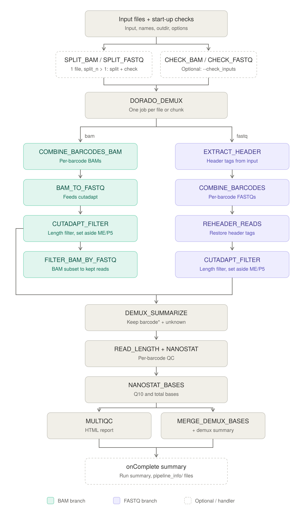

---
output:
  html_document: default
  word_document: default
---
# ConstruX-demux

Demultiplexing pipeline for seqWell ConstruX ONT libraries (plasmid and amplicon).


[](https://github.com/seqwell/ConstruX-demux/actions/workflows/nextflow-ci.yml?query=branch%3Amain)
[](https://www.nextflow.io/)


## Intended Use

ConstruX-demux demultiplexes Oxford Nanopore data from seqWell **ConstruX** libraries of **plasmids and amplicons**, barcoded with the seqWell 384 barcode set. It starts from basecalled ONT reads in FASTQ or unaligned BAM format, typically MinKNOW's `fastq_pass` / `bam_pass` folders, or the output of Dorado basecalling run separately. It has been tested with MinKNOW output. It delivers clean per-barcode reads for downstream analysis such as plasmid assembly or amplicon checks.

## Summary

This Nextflow pipeline demultiplexes ONT data generated with seqWell ConstruX library preparation using Dorado. It accepts either **BAM** or **FASTQ** input (gzipped or uncompressed) and follows a branching processing strategy depending on input type, producing cleaned **FASTQ** output files (and filtered **BAM** output for BAM input) with QC reports.

Barcodes are identified from the left (5′) end of each read, using the seqWell 384 barcode set (see [Barcodes](#barcodes)).

Before demultiplexing, the pipeline checks the input paths, file names, options and output folder, and stops with a plain-language message if something is wrong. Reading the files themselves for corruption is optional ([`--check_inputs`](#--check_inputs), [`--check_all_inputs`](#--check_all_inputs)), except for a single file that is split, which is always checked. When the input is a **single file**, the pipeline can optionally split it into chunks and run Dorado on each chunk in parallel (see [`--split_n`](#--split_n)).

## Pipeline Overview

Every run starts with the `CHECK_INPUTS` subworkflow, then splits into two branches by input type. In both branches, an optional split step runs first when there is only one input file:

```
                        ┌─────────────────────────────────────────────┐
                        │        CHECK_INPUTS (both branches)         │
                        │                                             │
                        │  start-up checks (input, names, outdir)     │
                        │        ↓                                    │
                        │  optional: CHECK_FASTQ / CHECK_BAM          │
                        │  (--check_inputs / --check_all_inputs)      │
                        │  or SPLIT_* for a single file (see below)   │
                        └─────────────────────────────────────────────┘

                        ┌─────────────────────────────────────────────┐
                        │              BAM INPUT BRANCH               │
                        │                                             │
  *.bam files ─────────→ [SPLIT_BAM]  (only if 1 file & split_n > 1) │
                        │        ↓                                    │
                        │ DORADO_DEMUX (--no-emit-fastq)              │
                        │        ↓                                    │
                        │ COMBINE_BARCODES_BAM                        │
                        │        ↓                                    │
                        │  BAM_TO_FASTQ  (samtools)                   │
                        │        ↓                                    │
                        │  CUTADAPT_TRIM                              │
                        │        ↓                                    │
                        │  FILTER_BAM_BY_FASTQ  (samtools)            │
                        │  (subset demux BAM by trimmed FASTQ IDs)    │
                        │        ↓                                    │
                        │  FASTQ + filtered BAM outputs               │
                        └─────────────────────────────────────────────┘

                        ┌─────────────────────────────────────────────┐
                        │             FASTQ INPUT BRANCH              │
                        │                                             │
  *.fastq(.gz) files ──→ [SPLIT_FASTQ] (only if 1 file & split_n > 1)│
                        │        ↓                                    │
                        │  EXTRACT_HEADER  (python → uuid_tags.tsv)   │
                        │        ↓                                    │
                        │  DORADO_DEMUX (--emit-fastq)                │
                        │        ↓                                    │
                        │  COMBINE_BARCODES                           │
                        │        ↓                                    │
                        │  REHEADER_READS (ONT metadata → SAM tags)   │
                        │        ↓                                    │
                        │  CUTADAPT_TRIM                              │
                        │        ↓                                    │
                        │  FASTQ outputs only (no BAM created)        │
                        └─────────────────────────────────────────────┘

                        ┌─────────────────────────────────────────────┐
                        │        SHARED DOWNSTREAM QC (both branches) │
                        │                                             │
                        │  DEMUX_SUMMARIZE → READ_LENGTH + NANOSTAT   │
                        │                          ↓                  │
                        │       NANOSTAT_BASES, MULTIQC,              │
                        │       MERGE_DEMUX_BASES                     │
                        └─────────────────────────────────────────────┘
```

Validated on E. coli amplicon pools (96- to 384-plex): crosstalk 0.04–0.18% after demultiplexing.

### Input Checks and Optional Split (both branches)

These steps run in the `CHECK_INPUTS` subworkflow (`subworkflows/check_inputs.nf`); demultiplexing starts only after they pass.

**Start-up checks** run before any task and stop the run immediately with a message that names the problem and the fix:
- `--input` is missing, does not exist, is empty, or contains no files of the chosen `--data_type` (with a hint such as "Did you mean --data_type bam?" when the other type is found, and a suggested glob when the reads are in sub-folders).
- File names contain spaces, or two files would get the same sample name (e.g. `sampleA.fastq` and `sampleA.fastq.gz`).
- `--outdir` is missing or cannot be written (local paths).
- Invalid option values, e.g. `--data_type fasta` or `--check_inputs maybe`.

**Input check (optional).** Reading every input file end to end before Dorado starts finds corrupt, truncated or empty files and stops with one message listing them. Because it reads the inputs an extra time, it is **off by default**; turn it on when you are unsure about the files, or when a run fails while reading an input file (the failure summary suggests it):
- `--check_inputs`: read the first and last file (natural sort, e.g. `_9` before `_10`), since an interrupted copy most often affects the last file.
- `--check_all_inputs`: read every input file (one check task per file).
- A single file that is split (the default for one input file) is always checked by the split step, at no extra cost.

For a large single file with `--split_n 1`, the check reads the whole file before demultiplexing starts (roughly 10–17 minutes for a 30 GB `.fastq.gz`), so only turn it on if you need it.

0. **SPLIT_FASTQ / SPLIT_BAM**: Runs only when the input directory contains exactly **one** file and `--split_n` is greater than 1. The file is split into `split_n` roughly equal chunks, and each chunk becomes its own `DORADO_DEMUX` job, so demultiplexing runs in parallel. The chunks are named `<sample>.part_NNN`.
   - **SPLIT_FASTQ** uses `seqkit split2` and always writes gzipped chunks, whether the input was `.fastq` or `.fastq.gz`.
   - **SPLIT_BAM** uses `samtools` + `awk` to distribute records round-robin across chunks. Every chunk keeps the full BAM header, and aux tags (e.g. MM/ML, RG) are preserved.

   With multiple input files, or with `--split_n 1`, no splitting is done.

### BAM Input Steps

1. **DORADO_DEMUX** (BAM mode): Demultiplexes input BAMs (or BAM chunks) using Dorado with the custom 384 seqWell barcodes, read from the left (5′) end of each read. Emits per-sample BAM directories (no FASTQ). Dorado threads are set to the task's CPU allocation (`--threads ${task.cpus}`), which is sized from the input file or set explicitly (see [Dorado resources](#dorado-resources)).

2. **COMBINE_BARCODES_BAM**: Merges per-barcode BAM files from multiple demux directories into one BAM per barcode.

3. **BAM_TO_FASTQ**: Converts each per-barcode demuxed BAM to FASTQ using samtools. This FASTQ is used as input to Cutadapt. No header extraction step is needed for BAM input.

4. **CUTADAPT_TRIM**: Two-step adapter trimming on the converted FASTQ:
   - Step 1: Drops reads shorter than [`--length_filter`](#--length_filter). (Dorado has already trimmed the barcode and its flanking adapter sequences.)
   - Step 2: Sets aside any read that still contains a seqWell adapter, ME (Mosaic End, `AGATGTGTATAAGAGACAG`) or P5 (`AATGATACGGCGACCACCGAGATCTACAC`), in either orientation and anywhere in the read, allowing errors up to [`--error_rate`](#--error_rate). These ME/P5-tagged reads are written to `.ME.tagged.fastq.gz` (removed from final output); clean reads go to `.seqWell.fastq.gz`. Most ME/P5-tagged reads are chimeras (two library molecules joined together). In pooled plasmid and amplicon libraries, a chimera would otherwise place one sample's sequence under another sample's barcode; setting these reads aside removes this source of crosstalk.

5. **FILTER_BAM_BY_FASTQ**: Subsets the demux BAM to retain only reads whose names appear in the trimmed FASTQ. This propagates cutadapt adapter/length/ME-tag filtering back onto the BAM. Keys are matched on bare barcode ID (e.g. `barcode001`).

### FASTQ Input Steps

1. **EXTRACT_HEADER**: Runs `extract_fastq_tags.py` **before** demultiplexing, per input file or per chunk. It parses the Dorado FASTQ header `key=value` fields and converts them to SAM-format tags: `ch`→`ch:i`, `read`→`rn:i`, `start_time`→`st:Z`, `flow_cell_id`→`fn:Z`, `runid`→`RG:Z`, `barcode`→`BC:Z`, `barcode_score`→`bs:i`, `protocol_group_id`→`px:Z`, `sample_id`→`si:Z`, `parent_read_id`→`pi:Z`, and `basecall_model_version_id`→`bv:Z`. Fields not in this map are dropped. Accepts gzipped or uncompressed FASTQ (detected from file contents, not the extension). Writes a UUID-keyed TSV (`<sample>.uuid_tags.tsv`) that REHEADER_READS uses to restore this metadata as SAM-format tags after Dorado demux strips it.

2. **DORADO_DEMUX** (FASTQ mode): Demultiplexes input FASTQs (or FASTQ chunks) using Dorado with the custom 384 seqWell barcodes, read from the left (5′) end of each read. Dorado reads gzipped or uncompressed FASTQ directly. Emits per-sample FASTQ directories (`--emit-fastq`, uncompressed). Dorado threads are set to the task's CPU allocation (`--threads ${task.cpus}`), which is sized from the input file or set explicitly (see [Dorado resources](#dorado-resources)).

3. **COMBINE_BARCODES**: Merges per-barcode FASTQ files from multiple demux directories into one gzipped FASTQ per barcode.

4. **REHEADER_READS**: Restores ONT header metadata as SAM-format tags in each per-barcode FASTQ, by joining on read UUID against the TSVs from EXTRACT_HEADER. Output headers look like `@<uuid> ch:i:123 rn:i:456 st:Z:... RG:Z:...`. The original `key=value` fields are not reproduced verbatim, and fields not mapped by EXTRACT_HEADER are dropped. Only the tags for reads in that barcode are loaded, so memory scales with the barcode's read count rather than with the whole run.

5. **CUTADAPT_TRIM**: Two-step adapter trimming on the reheadered FASTQ (same logic as BAM branch). No BAM files are created for FASTQ input.

### Shared Downstream QC (Both Branches)

6. **DEMUX_SUMMARIZE**: Generates a per-barcode read count summary CSV from the trimmed FASTQs. Only barcodes listed in this report (`barcode*` or `unknown`) go on to the QC steps below. If fewer than 50% of reads are assigned to a barcode, the run still completes but prints a warning to check the library type and barcode set.

7. **READ_LENGTH**: Counts reads per length in one pass and plots the read length distribution (and a length-weighted version) per barcode. For plasmids, the read-length plot normally shows a sharp peak at the full plasmid length; for amplicons, the distribution is broader. The length-weighted plot shows which read lengths contribute most of the bases, making barcodes easy to compare.

8. **NANOSTAT**: Produces detailed per-sample sequencing statistics.

9. **NANOSTAT_BASES / MERGE_DEMUX_BASES**: Collect bases per barcode and add them to the demux summary.

10. **MULTIQC**: Aggregates NanoStat results into a single interactive HTML report.





## Barcodes

The seqWell 384 barcodes are in `assets/barcodes.384.fa`, named `sw-BC001` … `sw-BC384`. `assets/arrangement.toml` (arrangement `sw`, passed to Dorado as `--kit-name sw`) tells Dorado to read the barcode from the left (5′) end of each read, between the flanking sequences given by `mask1_front` and `mask1_rear`. Reads without an identifiable barcode are reported as `unclassified`.

To use your own barcode set, pass `--barcodes` and `--arrangement_toml` together; the FASTA record names must match the arrangement's `barcode1_pattern` (for the default files, `sw-BC%03i`).

## Dependencies

- **Nextflow** 24.04 or newer (tested with 24.04.0, 24.04.4, 24.10.0, 24.10.5, 25.04.8, 25.10.0 and 26.04.6)
- **Docker**, or **Singularity / Apptainer** (`-profile singularity` or `-profile apptainer`) where Docker isn't available, e.g. on HPC clusters

### Docker Containers

| Process | Container |
|---|---|
| CHECK_FASTQ | `quay.io/biocontainers/seqkit:2.13.0--he881be0_0` |
| CHECK_BAM | `quay.io/biocontainers/samtools:1.21--h50ea8bc_0` |
| SPLIT_FASTQ | `quay.io/biocontainers/seqkit:2.13.0--he881be0_0` |
| SPLIT_BAM | `quay.io/biocontainers/samtools:1.21--h50ea8bc_0` |
| DORADO_DEMUX | `ontresearch/dorado:sha9809639e07a927bcc0f584dadd5e59674cf59f3f` (dorado 2.1.1) |
| COMBINE_BARCODES | `quay.io/biocontainers/samtools:1.21--h50ea8bc_0` |
| COMBINE_BARCODES_BAM | `quay.io/biocontainers/samtools:1.21--h50ea8bc_0` |
| EXTRACT_HEADER | `quay.io/biocontainers/pysam:0.22.0--py39hcada746_0` |
| REHEADER_READS | `seqwell/python:v2.1` |
| CUTADAPT_TRIM | `quay.io/biocontainers/cutadapt:5.0--py310h1fe012e_0` |
| BAM_TO_FASTQ | `quay.io/biocontainers/samtools:1.21--h50ea8bc_0` |
| FILTER_BAM_BY_FASTQ | `quay.io/biocontainers/samtools:1.21--h50ea8bc_0` |
| DEMUX_SUMMARIZE | `ubuntu:20.04` |
| READ_LENGTH | `seqwell/python:v2.1` |
| NANOSTAT | `quay.io/biocontainers/nanostat:1.6.0--pyhdfd78af_0` |
| NANOSTAT_BASES | `ubuntu:20.04` |
| MERGE_DEMUX_BASES | `ubuntu:20.04` |
| MULTIQC | `quay.io/biocontainers/multiqc:1.25.1--pyhdfd78af_0` |

## How to Run the Pipeline

### Required Parameters

#### `--input`
Where the reads are: a directory, a single file, or a quoted glob (e.g. `'run1/*.fastq.gz'`). Files must match the specified `--data_type`:

- `--data_type bam`: `*.bam`
- `--data_type fastq`: `*.fastq.gz`, `*.fq.gz`, `*.fastq` or `*.fq` (gzipped and uncompressed files are both accepted)

Supports local paths and AWS S3 URIs. Only files directly inside a directory are used; for reads in sub-folders (e.g. `fastq_pass/barcode01/`), use a glob such as `'fastq_pass/*/*.fastq.gz'`. File names must not contain spaces.

#### `--data_type`
Specifies the input file format. Must be either `bam` or `fastq`.

```bash
--data_type bam      # input directory contains *.bam files
--data_type fastq    # input directory contains *.fastq(.gz) / *.fq(.gz) files
```

BAM input produces both **FASTQ and filtered BAM** outputs. FASTQ input produces **FASTQ outputs only** — no BAM files are created.

#### `--outdir`
Output directory path. Supports local paths and AWS S3 URIs.

#### `--pool_ID`
A unique identifier for the sequencing run. Used in the demux summary report filename.

#### `--barcodes`
Path to the barcode FASTA file. Defaults to `assets/barcodes.384.fa`.

#### `--arrangement_toml`
Path to the barcode arrangement TOML for Dorado. Defaults to `assets/arrangement.toml`.

#### `--length_filter`
Minimum read length to retain after trimming. Default: `150`.

#### `--error_rate`
Maximum error rate for detecting the ME and P5 adapters in step 2 of **CUTADAPT_TRIM**. Cutadapt allows `floor(error_rate × matched adapter length)` errors (mismatches or indels), so the default `0.106` allows 2 errors in a full 19-nt ME and 3 in the full 29-nt P5. Reads with a match are set aside as ME/P5-tagged. Default: `0.106`.

### Optional Parameters

#### `--split_n`
Number of chunks to split the input into when the input directory contains a **single** file. Each chunk is demultiplexed by its own Dorado job in parallel. Default: `15`.

- `--split_n 1` disables splitting. The single file is demultiplexed as one Dorado job.
- Ignored when the input directory contains more than one file. Each file is already its own Dorado job.

Splitting usually shortens wall-clock time on AWS Batch, where many small jobs run concurrently. On a single machine, the gain depends on the number of available cores.

#### `--check_inputs`
Read the first and last input file end to end before Dorado starts, and stop with a clear message if either is corrupt, truncated or empty. Default: `false`.

#### `--check_all_inputs`
Read **every** input file end to end before Dorado starts and list any bad ones (one check task per file). Default: `false`. Recommended when a run fails while reading input files; it does not need `--check_inputs` as well.

> These checks re-read the input, which takes a while for large files (roughly 10–17 minutes per 30 GB of `.fastq.gz`). A single file that is split is always checked by the split step, whatever these options say.

Both are off unless given. Write --check_inputs on its own, or --check_inputs true, to switch it on; false, no and 0 switch it off; yes and 1 also mean on.

### Dorado Resources

`DORADO_DEMUX` CPU and memory are chosen per task in one of two ways:

1. **Fixed**, if `--dorado_cpus` and/or `--dorado_mem` are set. The value applies to every Dorado task.
2. **Automatic** (default), by the size of the file each task receives, using `--large_input_gb`.

Each of `--dorado_cpus` and `--dorado_mem` overrides independently. For example, setting only `--dorado_cpus` fixes the CPUs, and memory is still sized automatically.

#### `--large_input_gb`
Size threshold, in GB, for automatic sizing. Default: `1`.

| File received by the DORADO_DEMUX task | Resources |
|---|---|
| ≤ `large_input_gb` | 2 CPU / 7 GB |
| > `large_input_gb` | 4 CPU / 15 GB |

The size is checked per task, on the file that task demultiplexes: a split chunk, one of several input files, or a whole unsplit file. In practice:

- **Split chunks and normal `fastq_pass/` files** are usually small and get 2 CPU / 7 GB.
- **A single large file run with `--split_n 1`** gets 4 CPU / 15 GB automatically, so Dorado isn't stuck on 2 threads.
- **Very large inputs split into few chunks** can produce chunks above the threshold, which then also get 4 CPU / 15 GB. Raise `--split_n` to keep chunks small if you prefer more, smaller jobs.

Decimal values are accepted (e.g. `--large_input_gb 0.5`). Ignored for any resource set with `--dorado_cpus` / `--dorado_mem`.

#### `--dorado_cpus`
Fixed number of CPUs for **every** `DORADO_DEMUX` task. Dorado's `--threads` follows this value. Default: not set (automatic sizing).

#### `--dorado_mem`
Fixed memory, in GB, for **every** `DORADO_DEMUX` task. Accepts `32`, `32g`, `32G`, `32GB` or `'32 GB'`. Default: not set (automatic sizing).

> **Note:** fixed values apply to split chunks too. With the default `--split_n 15`, `--dorado_cpus 16` requests 15 × 16 CPUs. When fixing resources for a single large file, you usually also want `--split_n 1`.

> **Note:** with local execution, a task's CPUs and memory must fit on the machine (and in Docker Desktop's resource settings on macOS). On AWS Batch, the compute environment must offer an instance type large enough for the requested CPUs and memory, otherwise those tasks stay queued.

### Profiles

| Profile | Description |
|---|---|
| `standard` | Default. Runs locally with Docker. |
| `docker` | Explicit local Docker run. |
| `test` | Runs with built-in test data (`data_type=bam`). |
| `awsbatch` | Runs on AWS Batch. |
| `singularity` | Runs with Singularity instead of Docker (e.g. HPC). Images are pulled once into `./singularity_cache`. |
| `apptainer` | Same, with Apptainer. |

> **Singularity / Apptainer:** the first run converts each Docker image to a `.sif` file, which needs network access and disk space (the Dorado image alone is about 10 GB); later runs reuse the cache. To share one cache between runs or users, set `NXF_SINGULARITY_CACHEDIR` (or `NXF_APPTAINER_CACHEDIR`). On a cluster, combine with your scheduler settings, e.g. `-profile singularity -c my_slurm.config`.

### Example Commands

**Run the published release from GitHub** (no clone needed; `-r` pins the version):
```bash
nextflow run seqwell/ConstruX-demux -r v2.0.0 \
    --data_type fastq \
    --input /path/to/fastq_pass \
    --outdir /path/to/output \
    --pool_ID my_run
```

The examples below run from a local clone (`nextflow run main.nf`).

> **Tip:** with `-bg` the run continues in the background and its messages are not shown in the terminal. Add `> run.log` (e.g. `nextflow run main.nf ... -bg > run.log`) and read `run.log` to see progress and any error message.

**BAM input:**
```bash
nextflow run main.nf \
    --data_type bam \
    --input /path/to/bam/directory \
    --outdir /path/to/output \
    --pool_ID my_run \
    -resume -bg
```

**FASTQ input:**
```bash
nextflow run main.nf \
    --data_type fastq \
    --input /path/to/fastq/directory \
    --outdir /path/to/output \
    --pool_ID my_run \
    -resume -bg
```

**Single large FASTQ, split into 20 chunks:**
```bash
nextflow run main.nf \
    --data_type fastq \
    --input /path/to/single_fastq_directory \
    --outdir /path/to/output \
    --pool_ID my_run \
    --split_n 20 \
    -resume -bg
```

**Single large FASTQ, no split** (Dorado gets 4 CPU / 15 GB automatically if the file is larger than `--large_input_gb`):
```bash
nextflow run main.nf \
    --data_type fastq \
    --input /path/to/single_fastq_directory \
    --outdir /path/to/output \
    --pool_ID my_run \
    --split_n 1 \
    -resume -bg
```

**Single large FASTQ, no split, fixed Dorado resources:**
```bash
nextflow run main.nf \
    --data_type fastq \
    --input /path/to/single_fastq_directory \
    --outdir /path/to/output \
    --pool_ID my_run \
    --split_n 1 \
    --dorado_cpus 16 \
    --dorado_mem 32g \
    -resume -bg
```

**AWS Batch:**
```bash
nextflow run main.nf \
    -profile awsbatch \
    --data_type bam \
    --input s3://bucket/bam/ \
    --outdir s3://bucket/output/ \
    --pool_ID my_run \
    -resume -bg
```


### Test Run Commands

**BAM input:**
```bash
nextflow run main.nf \
    --data_type bam \
    --input "${PWD}/test_data/bam_pass/" \
    --outdir "${PWD}/bam_test_output" \
    --pool_ID test_bam \
    -resume -bg
```

**FASTQ input:**
```bash
nextflow run main.nf \
    --data_type fastq \
    --input "${PWD}/test_data/fastq_pass/" \
    --outdir "${PWD}/fastq_test_output" \
    --pool_ID test_fastq \
    -resume -bg
```


**single FASTQ input ( `--split_n`: 2):**
```bash
nextflow run main.nf \
    --data_type fastq \
    --input "${PWD}/test_data/large_merged_fastq/" \
    --outdir "${PWD}/10g_merged_fastq_test_output" \
    --pool_ID test_fastq \
    --split_n 2 \
    -resume -bg
```

**single FASTQ input (no split):**
```bash
nextflow run main.nf \
    --data_type fastq \
    --input "${PWD}/test_data/large_merged_fastq/" \
    --outdir "${PWD}/10g_merged_fastq_nosplit_test_output" \
    --pool_ID test_fastq \
    --split_n 1 \
    -resume -bg
```


## Expected Outputs

The output structure is the same whether or not the input was split.

```
output_directory/
├── demuxed_fastq/                          # Per-barcode subdirectories
│   ├── barcode001/
│   │   └── barcode001.seqWell.fastq.gz
│   ├── barcode002/
│   │   └── barcode002.seqWell.fastq.gz
│   └── ...
├── demuxed_fastq_flat/                     # Same files in flat structure
│   ├── barcode001.seqWell.fastq.gz
│   ├── barcode002.seqWell.fastq.gz
│   └── ...
├── demuxed_bam/                            # BAM output (BAM input mode only)
│   ├── barcode001/
│   │   └── barcode001.seqWell.bam          # Demux BAM filtered by trimmed FASTQ read IDs
│   ├── barcode002/
│   │   └── barcode002.seqWell.bam
│   └── ...
├── demuxed_bam_flat/                       # Same BAMs in flat structure (BAM input mode only)
│   ├── barcode001.seqWell.bam
│   ├── barcode002.seqWell.bam
│   └── ...
├── demux_summary/
│   └── <pool_ID>_demux_report.csv          # Per-barcode read counts + percentages
├── read_length/
│   ├── barcode001.seqWell.read_length_plot.png
│   ├── barcode001.seqWell.read_length_plot_weighted.png
│   └── ...
├── multiqc/
│   └── multiqc_report.html                 # Aggregated MultiQC report
├── other/
│   └── ME_tagged_fastq/
│       ├── barcode001.ME.tagged.fastq.gz   # ME/P5-tagged reads: contain a seqWell adapter (excluded)
│       └── ...
└── pipeline_info/                          # Logs, resource reports, run summary (see below)
```

Barcodes with no reads left after trimming get no output files.

## Logs, Resource Usage and Debugging

Every run (successful or not) writes a `pipeline_info/` folder inside `--outdir`:

| File | Contents |
|---|---|
| `execution_report.html` | CPU %, peak RAM, disk I/O and run time for every step, with plots |
| `execution_timeline.html` | When each task started and finished |
| `execution_trace.txt` | One tab-separated row per task (CPU, RAM, I/O, exit code, work directory) |
| `pipeline_dag.html` | Diagram of the workflow steps |
| `run_summary.txt` | The summary printed at the end of the run (settings, task counts, paths) |
| `nextflow.log` | Copy of the Nextflow log |
| `error_report.txt` | Failed runs only: the full error, including the failing step's command and error output |

If a run fails and you need help, send the whole `pipeline_info/` folder.


## Notes on BAM vs FASTQ Mode

- **BAM input** demuxes directly as BAM, converts to FASTQ for the Cutadapt length and ME/P5 checks, then filters the original demux BAM by the read IDs that pass these checks. This keeps the final BAM consistent with the FASTQ output — reads removed by Cutadapt (too short, ME/P5-tagged) are also removed from the BAM.
- **FASTQ input** extracts read headers *before* demuxing so that ONT header metadata can be restored as SAM-format tags after Dorado strips it during demux. No BAM files are produced in this mode.
- The FASTQ-internal processing approach (converting BAM→FASTQ before Cutadapt) avoids reliance on Cutadapt's unreliable BAM support for unaligned ONT reads.
- Barcode ID matching throughout the pipeline is keyed on the bare barcode label (e.g. `barcode001`), stripped of any filename suffixes, to ensure consistent joins between modules.

## Notes on Splitting

- Splitting only applies to a **single** input file. Multi-file inputs (e.g. a standard `fastq_pass/` directory) are already demultiplexed in parallel, one Dorado job per file.
- Chunks are intermediate files in the Nextflow work directory and are not published.
- `DORADO_DEMUX` resources are chosen per task from the size of the file it receives, unless fixed with `--dorado_cpus` / `--dorado_mem` (see [Dorado resources](#dorado-resources)), so split and unsplit runs are both sized sensibly without editing the config.
- Read order within each barcode may differ from the input order when splitting. This does not affect demultiplexing or downstream results.
- Dorado writes uncompressed FASTQ, so the work directory can be several times larger than the input during a run. Use `cleanup = true` in `nextflow.config` to remove the work directory after a successful run (this disables `-resume` for that run).
